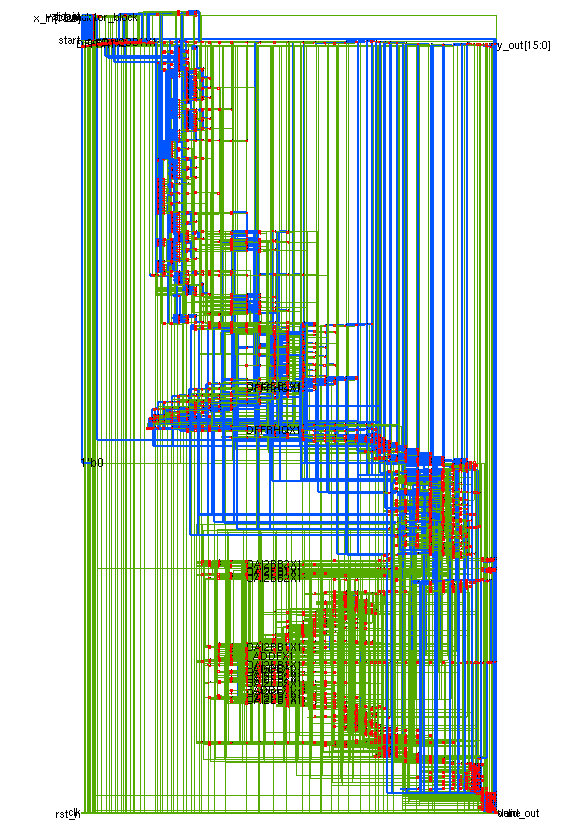
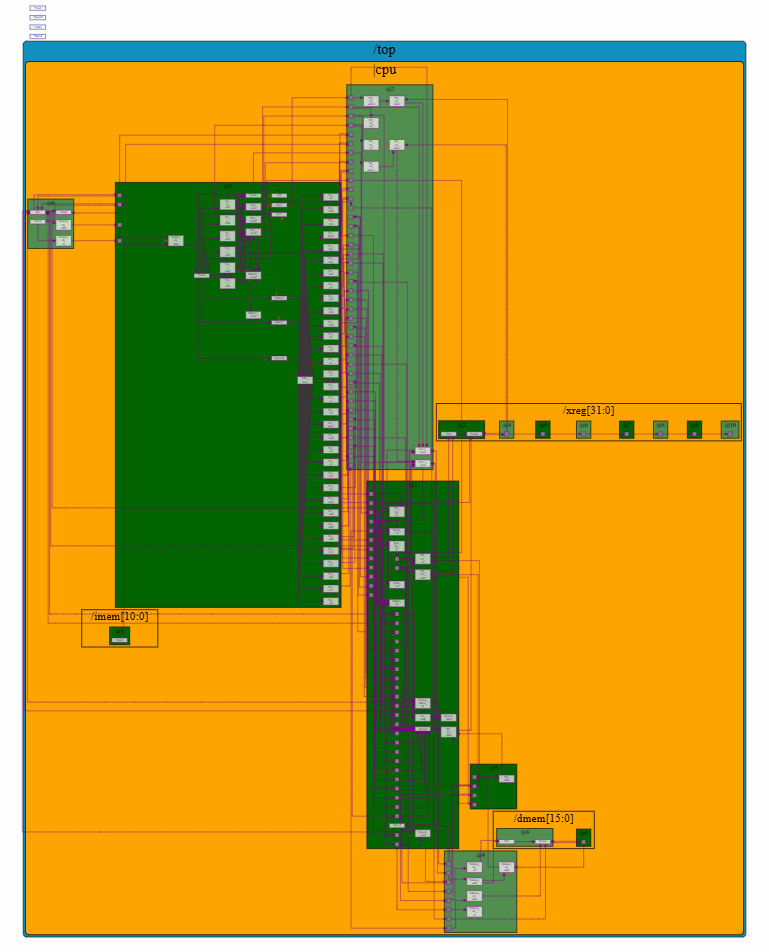
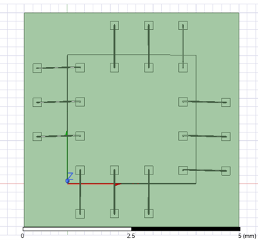
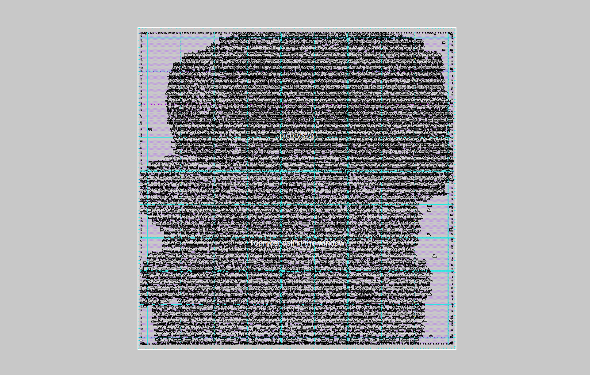

  
  
  
  
   
  <i>MAC Unit Netlist (Patent) &nbsp;·&nbsp; RISC-V Core (Makerchip) &nbsp;·&nbsp; Semiconductor Packaging (ANSYS) &nbsp;·&nbsp; GDSII Layout (Magic VLSI)</i>
    
  <h1>Preetham Senthil Kumar Kalpana</h1>
  
M.Sc. Nanoelectronic Systems @ TU Dresden &nbsp;·&nbsp; Semiconductor Technology 🇩🇪

  &nbsp;
  &nbsp;
  

I am an Electrical and Electronics Engineering graduate from VIT Chennai, currently pursuing an **M.Sc. in Nanoelectronic Systems at Technische Universität Dresden**, specializing in **Semiconductor Technology**. My technical background includes semiconductor chip implementation, RTL-to-GDSII workflows, physical design, and chip-level performance evaluation using Cadence Genus and Innovus across TSMC 180 nm and 90 nm technology nodes.

My academic and research work includes a published Indian patent application, a second patent application and an SCI journal manuscript under review, and an accepted book chapter with CRC Press. I am building on my chip implementation background through graduate studies in semiconductor technology, plasma technology, organic semiconductors, and related areas, with a growing interest in semiconductor processes, devices, process integration, and advanced manufacturing.

## Education

| Degree | Institution | Location | Period | Details |
|--------|------------|----------|--------|---------|
| **M.Sc. Nanoelectronic Systems — Semiconductor Technology** | Technische Universität Dresden | Dresden, Germany | October 2026 – Present | First-semester coursework: Semiconductor Technology 1, Plasma Technology, Organic Semiconductors for Optoelectronics, Confidential Computing, RoboLab Sessions |
| **B.Tech. Electrical and Electronics Engineering** | Vellore Institute of Technology | Chennai, India | September 2022 – April 2026 | CGPA: 9.2/10; German Grade Equivalent: 1.4; Class Rank: 12/220 |

## Publications & Patents

| # | Type | Title |
|---|------|-------|
| [01](https://github.com/PreethamSK163/Publication-1-Dynamic-Reconfigurable-Binary-Multiplier-Patent) | 🏛️ Patent Application [Published] | **Dynamic Reconfigurable Binary Multiplier System and Method Thereof** — Indian Patent Application No. 202541080342; published 19 September 2025. |
| [02](https://github.com/PreethamSK163/Publication-2-Softmax-Processing-Unit-Patent) | 🏛️ Patent Application [Under Review] | **Low-Power High-Performance Fixed-Point Softmax Processing Unit with LUT-Based Exponent and Mitchell Logarithmic Divider** |
| [03](https://github.com/PreethamSK163/Publication-3-Adaptive-Quadrant-Multiplier-SCI-Journal) | 📰 SCI Journal Manuscript [Under Review] | **Adaptive Quadrant Multiplier with Dynamic Reconfigurable Structure** |
| [04](https://github.com/PreethamSK163/Publication-4-FPGA-Solar-EV-Charging-Book-Chapter) | 📖 Book Chapter [Accepted] | **FPGA Based Solar Powered EV Charging Station: Smart Infrastructure for a Sustainable Future** — *Smart Technologies for Smart Buildings*, CRC Press, Taylor & Francis Group; ISBN: 9781041093626. |

## Selected Projects

| # | Project | Tools & Highlights |
|---|---------|-------------------|
| [01](https://github.com/PreethamSK163/Project-1-Digital-VLSI-SoC-Design-and-Planning) | **Digital VLSI SoC Design & Planning** | Verilog, OpenLANE, Sky130 PDK, Magic VLSI — PicoRV32a RTL-to-GDSII implementation, custom standard-cell integration, timing closure through ECO, DRC/LVS clean. |
| [02](https://github.com/PreethamSK163/Project-2-RISC-V-CPU-Design-using-TL-Verilog) | **RISC-V CPU Design using TL-Verilog** | TL-Verilog, Makerchip — 5-stage pipelined RV32I processor with data-hazard bypassing and branch control. |
| [03](https://github.com/PreethamSK163/Project-3-VLSI-Design-Automation-Using-TCL-VSDSYNTH) | **VLSI Design Automation Using TCL — VSDSYNTH** | TCL, Yosys, OpenTimer — Automated RTL-to-QoR flow; synthesis and timing analysis of openMSP430, 6,845 gates and 10,000 paths analysed. |
| [04](https://github.com/PreethamSK163/Project-4-SPI-Controller-Timing-Closure-and-Physical-Sign-off) | **SPI Controller — Timing Closure and Physical Sign-off** | Qflow, Yosys, Magic, Netgen — RTL-to-GDSII implementation; 3,106 cells, 22,417 routes, DRC/LVS clean. |
| [05](https://github.com/PreethamSK163/Project-5-RTL-Digital-Design-Modules-using-Verilog) | **RTL Digital Design Modules using Verilog** | Verilog HDL, ModelSim — Design and verification of UART, synchronous FIFO, Traffic Light, Temperature Controller, and Washing Machine FSM modules. |
| [06](https://github.com/PreethamSK163/Project-6-Packaging-Design-and-Simulation-using-ANSYS) | **Packaging Design and Simulation using ANSYS** | ANSYS Electronics Desktop — Flip-chip BGA thermal simulation, package modelling, and thermo-mechanical reliability analysis. |

## Internships & Research Experience

| Organization | Role | Key Contributions |
|--------------|------|-------------------|
| **Centre for Nano Electronics and VLSI Design (CNVD), VIT Chennai** | Summer Research Intern | Designed a 16×16 MAC unit using a Row Bypass Adder architecture; functional verification and gate-level synthesis using Cadence tools. |
| **Centre for Smart Grid Technologies (CSGT), VIT Chennai** | Summer Research Intern | Developed an 11-state FSM-based EV charging controller and Perturb & Observe MPPT algorithm in Verilog HDL. |
| **Maven Silicon** | VLSI Physical Design Intern | Completed RTL-to-GDSII implementation of an SPI controller using Qflow and OSU 0.18 µm technology; DRC/LVS clean. |
| **SkillDzire** | VLSI Design Intern | Designed and verified five FSM-based digital RTL modules using Verilog HDL and ModelSim. |

## Certifications & Technical Training

| Certification | Details |
|---------------|---------|
| **CeNSE Winter School on Semiconductor Technology** | Certificate of Distinction — Centre for Nano Science and Engineering, IISc Bengaluru, December 2025. |
| **Chip-based VLSI Design for Industrial Applications** | Specialization — L&T EduTech via Coursera, September 2025. |
| **RISC-V Processor — RV32I Base ISA** | Maven Silicon, February 2025. |

## Technical Skills

| Category | Skills |
|----------|--------|
| **HDL & Programming** | Verilog HDL, TL-Verilog, TCL, C, Python |
| **EDA & Physical Design** | Cadence NC Launch, Genus, Innovus, ModelSim, OpenLANE, Yosys, Magic VLSI, Qflow, Graywolf, Qrouter, Netgen, OpenTimer, Vesta |
| **Simulation & Analysis** | ANSYS AEDT, HSPICE, LTspice, MATLAB/Simulink |
| **Design Platforms** | Makerchip IDE, Eagle CAD, KiCad |
| **Technology Platforms** | Sky130 PDK, TSMC 180 nm and 90 nm technology nodes |
| **Operating Systems** | Linux, Windows |
| **Languages** | English (Fluent), Tamil (Native), German (Basic — University Level, Grade A) |

## Awards & Achievements

| Award | Details |
|-------|---------|
| **Danfoss Innovator Award 2025 — Finalist** | OXALIS DEPPEI dual-stage air filtration system, Danfoss University Engagement Team, VIT Chennai, February 2025. |
| **Robooceana Grand Finale — Certificate of Excellence** | National robotics competition; electronics team member for a Raspberry Pi-based hovercraft, IIT Madras Shaastra 2024, January 2024. |

## Extracurricular Activities

- **Editor — The Spectrum Technical Magazine:** Edited and curated technical content at VIT Chennai (2022–2025).
- **IEEE Student Chapter:** Volunteer Member, VIT Chennai (2022–2023).
- **VDAT 2024 — 28th International Symposium on VLSI Design and Test:** Participant, VIT Vellore (September 2024).

---

  Semiconductor Technology · Nanoelectronics · Chip Implementation · Physical Design

